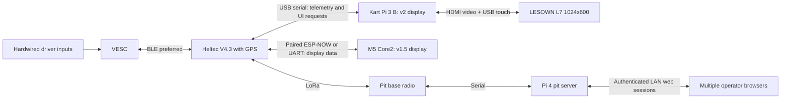

# Architecture and interface plan

This is the target design, not a deployed system. Framework and radio protocol
choices remain open pending hardware checks.

The diagram shows one kart; repeat it up to eight times. Kart-to-kart position
sharing uses direct/repeater reception in Eamon's current firmware. The M5 consumes those
fleet reports through the Heltec; no new pit fleet broadcast is required. Coverage and
eight-kart load measurements remain pending for the M5 assembly.

## M5 v1.5 alternative (2026-11-10)

The Core2 replaces the Pi/display assembly on a v1.5 kart. It does not replace the Heltec or
share BLE ownership. Firmware reuses the same radio protocol and motor policy; the optional
UART/paired ESP-NOW adapters and [display contract](../firmware/m5-core2/SERIAL_PROTOCOL.md) isolate local UI
requests. Both display versions can participate in the same eight-kart fleet. Local map
outlines are display data, not geofence enforcement. New map acceptance remains pending. The owner selected ESP-NOW for the local Heltec/Core2
link on November 10; UART remains available. Each pair uses private provisioned keys; the
Core2 follows the Heltec's Wi-Fi channel. This changes neither LoRa nor VESC BLE ownership.
The first wireless target is compile-time read-only, including pit/USB/game VESC writes.
Neither a base station nor an SD card is needed for own telemetry/direct peer GPS positions;
a validated course can be provisioned to Core2 internal NVS over USB, with optional SD fallback.
The north-up viewport follows a fresh own fix at a fixed local scale; distant peers do not
change the zoom. Without a fresh own fix it shows the available course with explicit status.
The base provides central pit/race functions. Neither it nor LoRa currently distributes course
geometry to the Core2. See the [M5 guide](../firmware/m5-core2/README.md) for provisioning.

Eamon's `core2-items` is a separate Pi-owned inventory accessory. Its raw ESP-NOW receive
callback is excluded from paired M5 builds, preserving authenticated link ownership. The M5
FIRE button remains unavailable until native inventory/game authority is ported; relaying
`invuse` to an absent Pi would not implement firing.

## Boundaries

| Component | Owns | Does not imply |
| --- | --- | --- |
| VESC | Hardwired throttle/reverse, motor control, configured protection; kart3 now has a local persistent reverse-filter commissioning trial | A tested guarantee of accessory-failure isolation |
| Kart Pi | Touchscreen rendering, map assets, presentation cache and UI requests | Ownership of the VESC link or control policy |
| Heltec V4.3 + L76K | VESC BLE client, telemetry, GPS, LoRa, validation/serialization of supervisory requests | Verified timing, fault isolation or implemented profile writes |
| Pit Pi 4 | Fleet/race state, authentication, command arbitration, radio session | An internet/cloud dependency |
| Browser | Operator interaction and live state | Direct ownership of the radio or authoritative command success |

## Owner-approved ownership change

The Heltec is the kart supervisor; the kart Pi is the display/interface only.
The Pi must not open a competing normal-operation VESC session. Touchscreen
profile selections, when enabled later, are requests to the Heltec. The Heltec
validates and serializes local and pit requests and reports the actual outcome.
The VESC still executes its own motor-control loop and hardwired driver inputs;
the Heltec does not stream throttle, braking or torque commands in this design.
The pit Pi 4 retains its server and fleet-management responsibilities.

This separation is intended to isolate VESC communications from Linux/UI load.
It is not a measured latency improvement. BLE connection parameters, firmware
scheduling, GPS parsing and radio airtime still determine observed delays. Keep
BLE servicing independent of blocking LoRa sends and USB/display backpressure;
use bounded queues, source timestamps and watchdogs. A missing display must not
stall the Heltec. Measure sample-to-screen age and command-to-confirmation delay
under simultaneous BLE, GPS, LoRa and UI load before selecting update rates.

The board's ESP32-S3 supports Bluetooth LE; verify the installed VESC module's
GATT service and compatibility. BLE stays preferred. Direct wired UART is a
possible later alternative after connector, voltage, pin allocation and existing
BLE-module occupancy checks, not an approved wiring change. USB serial to the
Pi is proposed and needs V4.3 firmware/connector validation.

Provide a validated regulated supply for the Heltec independent of the display
Pi if it must survive Pi power loss. Do not rely solely on Pi USB power. Check
USB power/backfeed and reset behavior before combining supplies; exact wiring
remains unselected. Power-source isolation is not yet tested.

Hardware capability sources: [Heltec V4](https://heltec.org/project/wifi-lora-32-v4/),
[Espressif ESP32-S3](https://www.espressif.com/en/products/socs/esp32-s3).
Capability documentation does not establish this project's runtime performance.

## Proposed contracts

The [agreed telemetry scope and proposed field conventions](requirements.md#agreed-telemetry-fields)
are the starting point for the shared application model. Final wire encoding and
update rates remain open; telemetry approval does not imply a deployed interface.

Use versioned records with explicit units, timestamp/age and validity. VESC
telemetry carries ERPM, currents, voltage, duty, temperatures and faults. GPS
records carry coordinates, fix state, age and available quality measures. Radio
records carry kart identity, sequence/session IDs and link quality.

The application model should keep source readings separate from derived MPH.
Configured wheel size/gearing/poles require physical verification. GPS speed
and driven-wheel speed are different during a drift; label the selected source.
Motor temperature is unavailable on the current hardware; never display raw 0 C
as a valid reading or invent it from ESC temperature.

The pit is the authority for race entry and operator commands. Multiple browsers
may control it; per-kart serialization, state revisions, command IDs and an audit
trail avoid racing/conflicting edits. Authentication is required; credentials
are deployment configuration, never committed defaults.

Radio commands need authentication, expiry, deduplication and per-recipient
outcomes. Acknowledging a packet is not proof that a VESC applied the setting.
Choose airtime/rate/payload together for eight karts and retain command capacity.

## Failure requirements

Reliability takes priority: display/Pi, Heltec, BLE, GPS and pit-link failures
must not trigger a driving-state change. Leave the ESC running its installed
firmware and last successfully applied active settings with hardwired inputs
and normal controller protections. This supersedes saved-profile restoration
on link loss; no communications-dependent profile lease is wanted.

Startup/reconnect is read-only reconciliation, not profile initialization.
Report stale data and unknown command outcomes honestly. Do not reset the VESC,
reapply a cached/default profile or replay queued commands when a link returns.
Future writes require a deliberate new request. Command expiry is about rejecting
old requests before execution, not undoing settings already applied.

This is a requirement, not a hardware-tested guarantee. Verify actual controller
input/timeout behavior and power/reset coupling on the bench. An ESC reboot or
power loss is distinct from an accessory/link outage and may load persisted
settings. Neither controller protections nor its timeout settings are modified
by this documentation change. See the [reliability acceptance checks](requirements.md#reliability-and-link-loss-behavior).

Remote stop and geofence enforcement remain deferred; lost communications or
GPS never implicitly enables either. Future geofence behavior on the Heltec,
including its failure boundaries, needs a separate explicit design decision.

## Map packaging

Store imagery locally with geographic transform/CRS and attribution. Store course
route, pits and future boundaries as separate geometry. The current site image
and actual course route are not yet supplied. Public CT ECO 2023 aerial imagery
is a candidate, not a downloaded asset. Do not transmit image tiles over LoRa.
